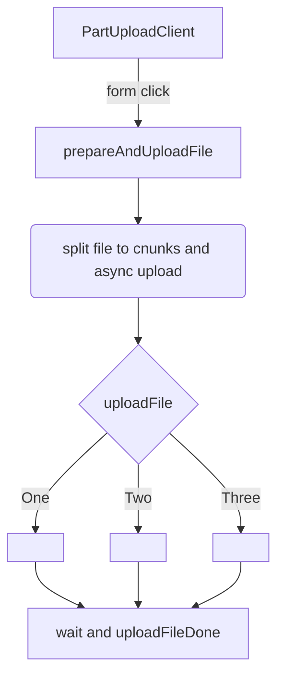

# Future


### LegacyUploader

This is current version `assets/index6.js`

But one day it will be switch to `PartUploadClient`, where

- full file split to the chunks
- these chunks upload with retry control
- these chunks upload to the server simultaneously


### PartUploadClient



```javascript

(() => {
    let uploadClient = new PartUploadClient({
        chunkSize: 25 * 1024 * 1024,
        retryDelay: 2000,
        maxRetries: 2,
        requestTimeout: 0, // disable timeout
        onProgress: (mode, chunkInfo, sizeSum, sizeValue) => {
            //console.info('onProgress', mode);

            if (mode == 'open') {
                $('#progress').setAttribute('max', 100);
                $('#progress').setAttribute('value', 'xxx');
                $('#progress').style.display = 'block';
            }

            if (mode == 'process_done') {
                $('#progress').setAttribute('max', sizeSum);
                $('#progress').setAttribute('value', sizeValue);
            }

            if (mode == 'close') {
                $('#progress').style.display = 'none';
            }
        },
        onComplete: (sessionInfo, js) => {
            console.info('onComplete', sessionInfo.name, js);

            if (js && js.code == 200) {
                //location.href = location.href;
            }
        },
        onError: (err) => {
            console.info('onError', err.name, err.message);
        },
        onFailed: (sessionInfo, chunkInfo) => {
            console.info('onFailed', sessionInfo, chunkInfo);
        },
    });

    //uploadClient.setupEventListener('#upload_file, #upload_file2');
})();

```


